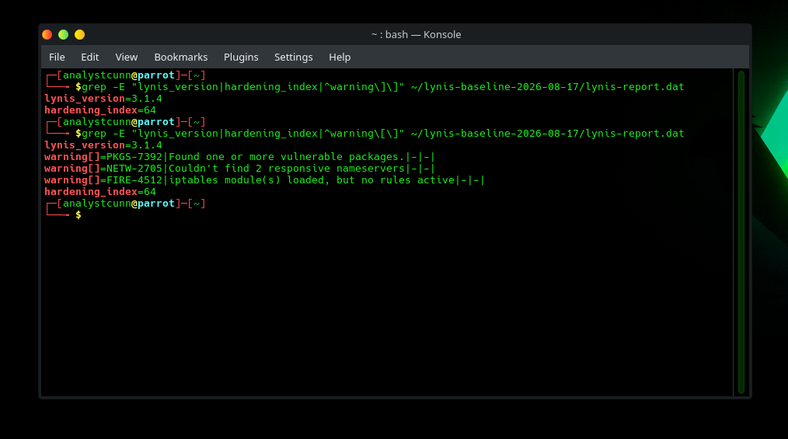
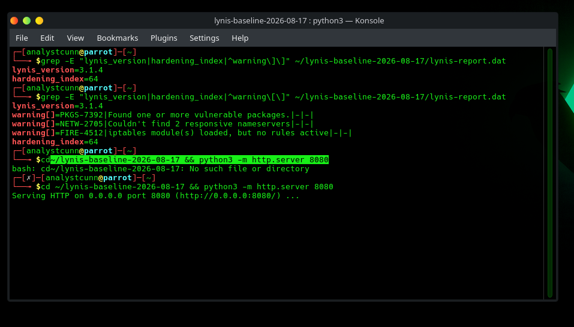
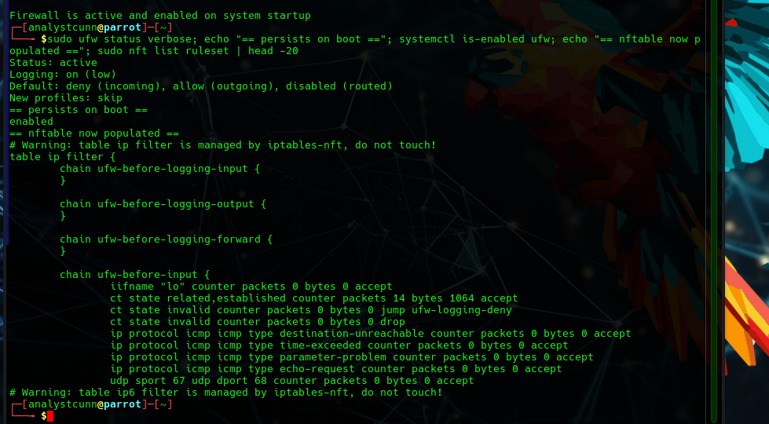
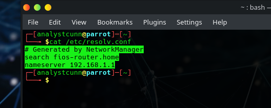
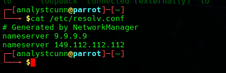
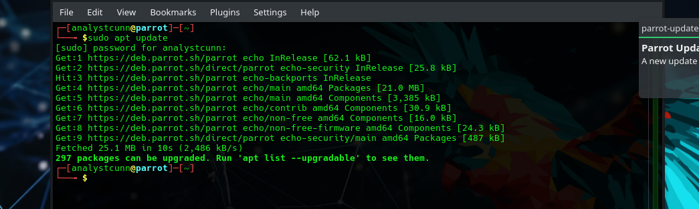
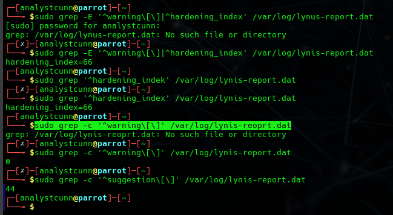
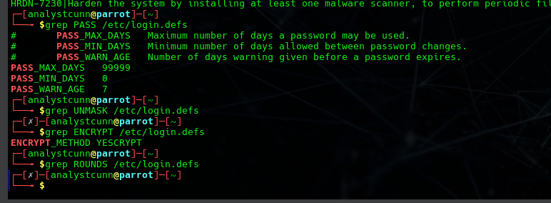
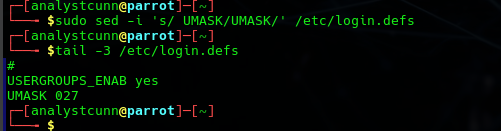

# Artifact 1: Manual Hardening of a Parrot Security Workstation

**Analyst:** Brandon Cunningham (`analystcunn`) · Google Cybersecurity Certificate
**Date:** 2026-08-20
**Environment:** Parrot Security 7.3 "echo" (Debian 13.5 base), VirtualBox VM, LUKS full-disk encryption
**Frameworks:** CIS Debian Benchmark (spine) + NIST SP 800-53 Rev. 5 control tags

📄 **[Download the full PDF report](Artifact-1-Parrot-Hardening.pdf)**

---

## 1. Executive summary

This project takes a freshly installed Parrot Security workstation from an unhardened baseline to a measurably hardened state, applying four controls and documenting, with equal rigor, the controls I **chose not to apply** and why.

Using Lynis 3.1.4 (run as root) as the measurement tool, the system moved from a baseline **hardening index of 64 with 3 warnings** to **66 with 0 warnings**. Each control was applied in isolation and re-measured, so every change's effect is individually attributable.

| Stage | Hardening index | Warnings | Key result |
|-------|:---:|:---:|------|
| Baseline (unhardened) | 64 | 3 | PKGS-7392, NETW-2705, FIRE-4512 |
| Control 1: Host firewall | 65 | 2 | FIRE-4512 cleared |
| Control 2: DNS resilience | 66 | 1 | NETW-2705 cleared |
| Control 3: Patching | 66 | 0 | PKGS-7392 cleared |
| Control 4: umask | 66 | 0 | AUTH-9328 cleared |

A deliberate finding of this project: the single most security-significant action, patching 297 packages including a vulnerable kernel, moved the hardening index by **zero**. That is treated not as a failure but as evidence that a hardening index is a poor *sole* metric, a theme returned to throughout.

---

## 2. Scope and rationale (read first)

Parrot Security is an **offensive-tooling distribution**, not a server. Hardening it is an unusual choice and an interviewer should be expected to probe it, so the rationale is stated up front:

An analyst workstation that holds penetration-testing tooling, client scoping data, and engagement artifacts is a **high-value target**. If it is compromised, an attacker inherits both the tooling and the client data. Hardening it is therefore defensible on a real-world basis.

Equally important is the **counter-discipline**: on a box whose purpose is unusual, I did **not** blindly chase the Lynis hardening index or apply every suggestion. Several findings are legitimately not applicable, redundant, or actively inappropriate for this system, and those decisions are documented in Section 7. The goal was defensible, attributable controls, not a higher number.

---

## 3. Environment and methodology

**System under test**

- Host: Lenovo ThinkPad T14 (16 GB RAM); guest VM on the internal NVMe SSD.
- Hypervisor: Oracle VirtualBox (VM `Parrot-Attacker`: 4096 MB RAM, 2 vCPU, 40 GB VDI, VBoxSVGA graphics, NAT networking).
- Guest OS: Parrot Security 7.3 "echo", Debian 13.5 base, confirmed via `lsb_release -a` / `/etc/os-release`.
- **LUKS full-disk encryption** enabled at install (btrfs inside the LUKS container, no swap), proven live at boot: the encryption-at-rest control (NIST **SC-28**).
- Autologin disabled: credentials required at login.

**Measurement discipline**

- Auditor: **Lynis 3.1.4** (pre-installed on Parrot, so the audit added no packages and kept the baseline pristine). Run as **root**, because an unprivileged run silently skips privileged tests and misreports the index.
- **Baseline snapshot** `baseline-unhardened` (powered off, 2026-08-17) is the fixed measurement reference. Each control was applied against this lineage and re-measured, so deltas are attributable.
- **Evidence integrity:** raw `lynis-report.dat` and `lynis.log` were archived before anything overwrote them, transferred to the host without installing anything in the guest (a temporary `python3 -m http.server` over a VirtualBox NAT port-forward), and hashed (`SHA256SUMS.txt`). Screenshots are classified STRONG (proves a control/result) or WORKING NOTE (context).

**Baseline result (2026-08-17):** hardening index **64**, 274 tests, **3 warnings** (`PKGS-7392` vulnerable packages, `NETW-2705` single nameserver, `FIRE-4512` firewall loaded with no ruleset), and 45 suggestions.



---

## 4. Control 1: Host firewall, default-deny (FIRE-4512)

**Risk.** The firewall engine was loaded but held **no ruleset**, so the effective policy was accept-all. Any service that started listening would be reachable with no boundary in place.

**Change.** I used **ufw** (already shipped and installed on Parrot, dormant), a supported front-end to the nftables engine. Policy was set *before* enabling so the firewall was never briefly live under the wrong defaults:

```
sudo ufw default deny incoming
sudo ufw default allow outgoing
sudo ufw enable
```

No inbound allow-rules were needed: the box runs no inbound services (SSH is off), so pure default-deny inbound is complete. `ufw enable` also enables it on boot, closing a persistence gap (the nftables service had been disabled).

**Verification.** `ufw status verbose` showed active, deny-in/allow-out; `nft list ruleset` was now populated with ufw chains including the stateful `ct state related,established accept` rule; an outbound `ping` confirmed connectivity and stateful return traffic still worked. A full re-audit moved the index **64 → 65**, cleared **FIRE-4512** (warnings 3 → 2), and flipped the Firewall component to `[V]`.

**Framework tags.** NIST **SC-7(5)** "deny by default, allow by exception" (direct match), supporting **CM-7** least functionality; CIS host-based firewall (ufw) family.




---

## 5. Control 2: DNS resilience (NETW-2705)

**Risk.** The system had a **single nameserver** (`192.168.1.1`), so a resolver outage would break name resolution entirely. This is an **availability** finding (redundancy), and is deliberately *not* claimed as an integrity or anti-phishing control (that would be DNSSEC and a filtering resolver, respectively).

**Change.** `/etc/resolv.conf` was generated by NetworkManager, so a direct edit would be overwritten; the change was made at the managing layer and pinned two vetted resolvers (Quad9), ignoring the DHCP-supplied one:

```
sudo nmcli connection modify "Wired connection 1" \
  ipv4.dns "9.9.9.9 149.112.112.112" ipv4.ignore-auto-dns yes
```

Quad9 was chosen because it performs DNSSEC validation and blocks known-malicious domains, a small content-trust bonus from the *resolver choice*, distinct from the redundancy that clears the finding.

**Verification.** `resolv.conf` then listed the two Quad9 servers; `getent hosts parrotsec.org` resolved correctly. A full re-audit moved the index **65 → 66** and cleared **NETW-2705** (warnings 2 → 1).

**Troubleshooting note.** Applying the change left the NIC in an `unmanaged` state (a failed `nmcli connection up` mis-selected the loopback device). Reading the device state via `nmcli device status` identified the cause; `sudo systemctl restart NetworkManager` re-managed the interface and re-applied the saved profile. Lesson: an `unmanaged` interface means NetworkManager isn't controlling it, and a service restart is a reliable recovery.

**Framework tags.** NIST **SC-22** (fault-tolerant name resolution) primary; **SC-21** (recursive resolver DNSSEC validation) supporting; SC-20 N/A (we are a client, not an authoritative server). No clean CIS mapping exists for "two nameservers": an honest gap where NIST carries the control.




---

## 6. Control 3: Patching (PKGS-7392)

**Risk.** The baseline was intentionally left un-patched so patching could be measured as its own attributable control. `apt update` showed **297 packages upgradable**, the debt behind the vulnerable-packages warning, including an outdated kernel.

**Change.** After taking a dedicated pre-patch snapshot (`pre-patch-2026-08-20`), I ran a full upgrade. `apt full-upgrade` was chosen over `apt upgrade` deliberately: plain `upgrade` never removes packages and would hold back any update whose dependencies require a removal, silently leaving patches un-applied. `full-upgrade` completes the transition.

```
sudo apt update
sudo apt full-upgrade
```

The transaction upgraded 297 packages, installed 7 (a new kernel `linux-image-7.0.13+parrot7` plus headers/modules), and removed 2 unused Mesa video-decode drivers (benign in a VM). A **reboot** followed, because a new kernel and libc are only active after reboot; `uname -r` then confirmed `7.0.13+parrot7-amd64`.

**Verification.** A full re-audit showed **0 warnings**: `PKGS-7392` cleared, and with it **all three baseline warnings resolved**. The hardening index remained **66** (unchanged).

**Analyst note (metric interpretation).** Clearing the vulnerable-packages warning moved the index by **zero**, unlike the firewall and DNS fixes (+1 each). A hypothesis that patching had introduced offsetting new suggestions was tested and rejected (suggestions were essentially flat, 45 → 44). The honest explanation is that the hardening index is a **weighted, rounded** aggregate of ~274 tests, and this finding's weight did not cross the rounding boundary to 67. This is the clearest evidence in the project that a hardening index is a poor *sole* metric: the most security-significant action taken, eliminating known-vulnerable code across 297 packages and the kernel, is best measured by the vulnerabilities removed, not by a score tick.

**Framework tags.** NIST **SI-2** (Flaw Remediation) primary, **RA-5** (Vulnerability Monitoring & Scanning) supporting; maps cleanly to CIS patch-management guidance.




---

## 7. Control 4: Restrictive default file permissions / umask (AUTH-9328)

**Risk.** `/etc/login.defs` set no `UMASK`, so the system defaulted to `022`, meaning new files are created **world-readable**. On a multi-user or multi-service system, that exposes newly created files to other local accounts by default.

**Change.** A restrictive default was added:

```
UMASK 027
```

**Verification (with an important nuance).** In a fresh login session (`su - analystcunn`), the effective umask read **`0007`, not `0027`**. This is expected: with `USERGROUPS_ENAB yes` and a user-private group (the primary group contains only this user), the login system relaxes the *group* bits, so `027` becomes `007`. The security-critical digit is unchanged: **"other" (world) = no access**, so new files are no longer world-readable, which was the goal. Distinguishing the **configured** umask (`027`) from the **effective** umask (`007`), and explaining why, is the substance of this control. A full re-audit cleared **AUTH-9328** (suggestions 44 → 43; warnings still 0; index 66).

**Framework tags.** NIST **AC-6** (Least Privilege) primary, **CM-6** (Configuration Settings) supporting; CIS "ensure default user umask is 027 or more restrictive."




---

## 8. Controls deliberately NOT applied (with rationale)

This section is where judgment shows. Each item below was flagged by the scanner or a benchmark and consciously **not** applied.

**SSH server hardening: Not applicable.** `systemctl is-active ssh` and `is-enabled ssh` both returned negative: the SSH server is neither running nor set to start. Removing a door beats hardening a door you don't need; documented as N/A rather than inventing a step.

**Increase SHA-512 hashing rounds (AUTH-9230): Not applicable.** The system already uses **yescrypt** (`ENCRYPT_METHOD YESCRYPT`), a modern memory-hard algorithm stronger than the SHA-512-with-rounds the finding suggests. The `SHA_CRYPT_MIN_ROUNDS` knob does not even apply to yescrypt; applying it would do nothing.

**Force periodic password expiry (AUTH-9286): Deliberately declined.** CIS/Lynis suggest a maximum password age. **NIST SP 800-63B recommends against** mandatory periodic rotation without cause, as it drives weaker, incrementing passwords. `PASS_MAX_DAYS 99999` (no expiry) was kept intentionally, documenting the CIS-vs-modern-NIST tension.

**Password-strength PAM module (AUTH-9262): Skipped.** `pam_pwquality` would add a package for modest value on a single-user workstation; declined as a conscious scope decision.

**fail2ban (DEB-0880): Low value here.** Bans hosts after failed authentication, but the box exposes no inbound services (SSH off, NAT, default-deny inbound), so there is nothing to brute-force.

**GRUB bootloader password (BOOT-5122): Largely redundant.** LUKS full-disk encryption already requires a passphrase before the system can boot at all, so a separate bootloader password adds little for this threat model.

**Disable USB/firewire storage drivers (USB-1000, STRG-1846): Not meaningful in a VM.** No physical peripheral bus is exposed to the guest.

**Unused network services (apache2, php, mariadb, nginx): Noted for future attack-surface reduction.** These arrived as dependencies during patching and are present but not run as services; the HTTP/PHP suggestions exist only because they are installed. Removing them would be a clean attack-surface-reduction control (NIST CM-7) and is recorded as a candidate follow-up.

---

## 9. Results

- **Hardening index:** 64 → **66**.
- **Warnings:** 3 → **0** (all baseline warnings cleared).
- **Suggestions:** 45 → **43** (with several more consciously declined per Section 8).

The headline number moved only two points, yet the substantive posture improved materially: a real firewall boundary, resilient DNS, a fully patched system on a current kernel, and restrictive default permissions. The gap between "index +2" and the actual work done is the central lesson: **use the index as a directional signal, not a scorecard.**

---

## 10. Lessons and troubleshooting highlights

The build surfaced several real problems, each resolved and documented, the kind of troubleshooting narrative that demonstrates method:

- **Live-ISO detection.** An early "install" was actually the live ISO running in RAM (`/proc/cmdline` showed `boot=live`); catching it prevented a baseline captured on an ephemeral system.
- **External-drive dropout.** Repeated install failures traced to a USB drive dropping mid-write (`DrvVD` / VDI pre-header read error); resolved by moving the VM to the internal SSD.
- **VMSVGA soft-lock.** The guest display stack hung on the default graphics controller; switching to VBoxSVGA resolved it.
- **Never reset during an install.** A blanked guest screen was mistaken for a hang; resetting corrupted an in-progress install. A blanked display is not a dead VM.
- **Unmanaged NIC.** Covered in Section 5: reading device state beat guessing.

---

## 11. Appendix

- **Evidence manifest & raw measurement data:** the Lynis `.dat`/`.log` files, their SHA-256 integrity hashes, the per-control in-guest archives that freeze each measurement, and the full working-note screenshot set are **retained privately and available on request**. They are deliberately kept out of this public repository as a data-handling choice; the polished report and its supporting screenshots above are the published evidence.
- **Tooling:** Lynis 3.1.4 (root), VirtualBox, ufw/nftables, NetworkManager/nmcli, apt.

*Prepared as part of a documented cybersecurity home-lab portfolio. Subsequent artifacts cover SIEM detection (Wazuh), Active Directory hardening, cloud misconfiguration remediation, and vulnerability management.*
