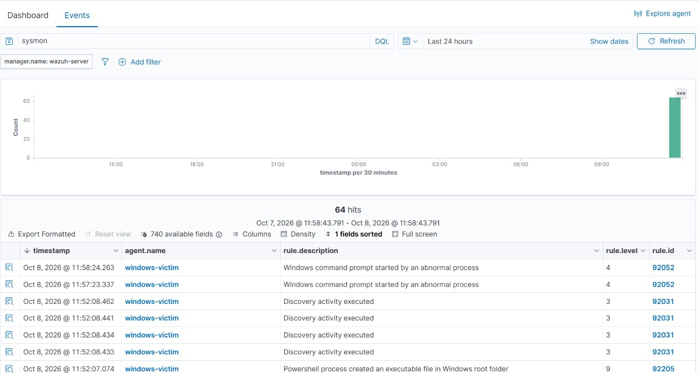
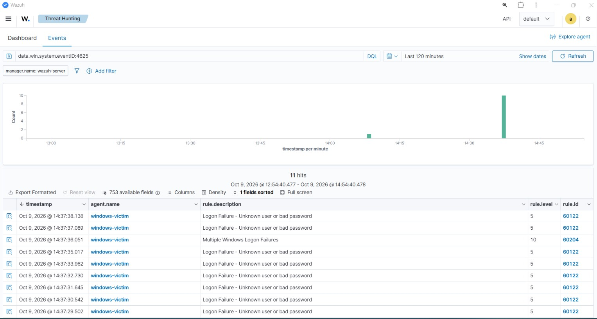
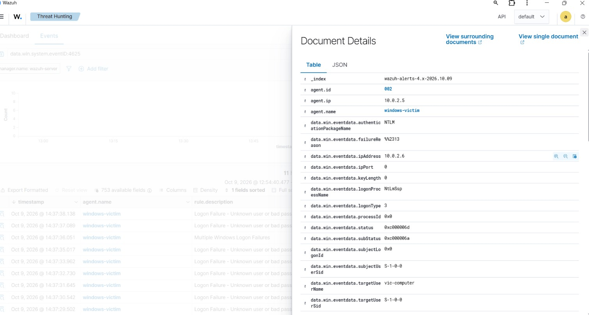

# Artifact 2, Unit 2: Windows Endpoint Detection with Wazuh

**Analyst:** Brandon Cunningham (analystcunn) | Google Cybersecurity Certificate
**Date:** 2026-10-09
**Environment:** Wazuh 4.14.7 all-in-one on Ubuntu Server 24.04.4 LTS; monitored Windows 11 Enterprise LTSC 2024 endpoint; Parrot Security 7.4 attacker; VirtualBox on a ThinkPad T14, isolated NAT Network (LabNet)
**Frameworks:** CIS Controls v8 (spine) + NIST SP 800-53 Rev. 5 tags + MITRE ATT&CK

This is the phase-2 continuation of Artifact 2. Unit 1 stood up the SIEM and detected an SSH brute-force on a Linux endpoint. Unit 2 extends the same SIEM to a Windows endpoint, adds richer process telemetry with Sysmon, and detects a Windows-native attack: an RDP brute-force.

## 1. Executive summary

Having proven the SIEM could detect and attribute an attack on Linux (Unit 1), the next step was covering a very different operating system. Windows is the dominant enterprise desktop and the most common ransomware entry point.

This unit enrolls a Windows 11 endpoint as a Wazuh agent, deploys Sysmon for high-fidelity process telemetry, and then detects an RDP (Remote Desktop Protocol) brute-force attack executed from the same Parrot attacker that was hardened in Unit 1. The SIEM correlated the raw Windows failed-logon events into a single attributed brute-force alert.

| Stage | Capability built | Key result / evidence |
| :---- | :---- | :---- |
| Enroll | Wazuh agent on Windows 11 | Agent active, ID 002, windows-victim, 10.0.2.5 (A2-S09) |
| Telemetry | Sysmon + SwiftOnSecurity config | Sysmon events reach and index on the manager (A2-S10, A2-S10b, A2-S10c) |
| Detect | RDP brute-force use-case | Rule 60204 "Multiple Windows Logon Failures" (level 10), srcip attributed (A2-S11, A2-S11a) |

**Headline result:** the Windows endpoint went from reporting to actively detecting. A burst of RDP password guesses produced Windows **event 4625** (failed logon); which the agent shipped to the manager, where rule **60122** flagged each failure. Then rule **60204** correlated them into a level-10 brute-force alert naming the attacker (data.win.eventdata.ipAddress **10.0.2.6**) and the target account (vic-computer). The alert maps to MITRE ATT&CK **T1110** (Brute Force) and NIST **AC-7, SI-4, AU-6, IR-4**. Detection, not prevention, was the scoped objective, and it is met end to end on Windows.

## 2. Scope and rationale

**A second OS on purpose.** Unit 1 proved the loop on Linux. Re-proving it on Windows shows the detection model is OS-independent and that I can work the Windows logging stack (Security event log, Sysmon), which is where most enterprise detection actually happens.

**Sysmon, not just the default Windows logs.** The native Windows logs are coarse. Sysmon (System Monitor) adds detailed, attacker-relevant process, network, and file telemetry. Deploying it with the community-standard SwiftOnSecurity configuration is a more realistic baseline, and it sets up far richer detection than the stock logs alone.

**Detection, not prevention.** As in Unit 1, the objective is to see and attribute the attack. Automatic blocking (Wazuh active response) is deliberately deferred to Unit 4; see section 5.

**A controlled, non-destructive attack.** The RDP brute-force used a wordlist of deliberately wrong passwords, so the account was never compromised. The goal was to trigger the detection, not to gain access.

**Host-based scope (HIDS).** The Wazuh agent watches the endpoint's own logs. This unit detects from inside the host; network-level detection is out of scope.

## 3. Environment and methodology

| Role | VM | OS | Address | Purpose |
| :---- | :---- | :---- | :---- | :---- |
| Monitored endpoint | Windows-Victim | Windows 11 Enterprise LTSC 2024 Eval | 10.0.2.5 (DHCP) | Runs the Wazuh agent + Sysmon; RDP exposed |
| Attacker | Parrot OVA | Parrot Security 7.4 | 10.0.2.6 (DHCP) | Runs hydra against RDP |

The existing Wazuh manager (10.0.2.10) and the Unit 1 Ubuntu victim remain. Host is a ThinkPad T14, 16 GB RAM; VMs run on the internal SSD.

## 4. Capabilities applied

### 4.1 Windows endpoint enrollment

**Risk.** The Windows endpoint is an unmonitored blind spot until it forwards its logs.

**Change.** Installed the Wazuh agent (v4.14.7, matching the manager) on the Windows 11 victim, pointed at the manager's real LabNet address (10.0.2.10). RDP was enabled (fDenyTSConnections = 0) as the attack surface for the later use-case.

**Verification.** The dashboard Agents view showed windows-victim, ID 002, IP 10.0.2.5, OS Windows 11 Enterprise LTSC 2024 Evaluation, agent v4.14.7, **status active (green)** (A2-S09).


**Framework tags.** NIST **AU-2** (event logging), **AU-12** (audit record generation): the agent is the source of Windows audit records; **SI-4** supporting. CIS **Control 8** (Audit Log Management).

### 4.2 High-fidelity telemetry with Sysmon

**Risk.** The default Windows Security log alone misses a lot of attacker behavior; such as detailed process creation, command lines, parent-child process relationships. Without richer telemetry, many techniques are invisible.

**Change.** Installed **Sysmon v15.22** on the victim with the **SwiftOnSecurity** configuration (to `C:\Tools\Sysmon`), then told the Wazuh agent to collect the Sysmon channel by adding a localfile block for Microsoft-Windows-Sysmon/Operational to the agent's ossec.conf and restarting the agent service.

**Verification.** Locally, Event Viewer showed Sysmon Event ID 1 (Process Create) events accumulating (A2-S10). On the SIEM, a Threat Hunting search for sysmon returned a live-growing cluster of hits (A2-S10b), and an expanded event confirmed the data was genuinely Sysmon-sourced: data.win.system.providerName = **Microsoft-Windows-Sysmon**, message "Process Create:" (A2-S10c). This proves the full path: Sysmon on the host, the agent shipping its channel, the manager indexing it.




**Framework tags.** NIST **AU-2 / AU-12** (richer audit generation), **SI-4** (system monitoring). CIS **Control 8**.

### 4.3 Detection use-case: RDP brute-force

**Risk.** RDP (TCP 3389) exposed with password authentication is one of the most attacked Windows services on the internet and a primary ransomware entry vector. The endpoint deliberately exposes RDP so this attack path exists to detect (MITRE ATT&CK **T1110**).

**Change (attack).** The Parrot attacker, ran a controlled brute-force with hydra against the victim's RDP, using a short list of deliberately wrong passwords, looped four times:

```
for i in 1 2 3 4; do hydra -l vic-computer -P wl.txt rdp://10.0.2.5 -t 1 -V; done
```

Each failed attempt causes Windows to write a **4625** (failed logon) record, which the agent forwards to the manager.

**Verification (detection).** In Threat Hunting, a search for data.win.system.eventID:4625 returned **11 hits** in one tight spike at the attack time. The manager classified and correlated them:

- **Rule 60122** "Logon Failure - Unknown user or bad password" (level 5), one per failed attempt.
- **Rule 60204** "Multiple Windows Logon Failures" (level 10), the correlation alert that distinguishes a brute-force from an isolated typo (A2-S11).

The expanded event attributes the attack (A2-S11a): data.win.eventdata.ipAddress **10.0.2.6** (the Parrot attacker), targetUserName **vic-computer** (the target account), subStatus **0xc000006a** (wrong password, confirming failed guesses), authenticationPackageName NTLM, logonType 3. A useful distinction for an analyst: agent.ip 10.0.2.5 is the victim that reported the event, while ipAddress 10.0.2.6 is the source that performed the attack.






**Framework tags.** NIST **SI-4** (detection), **AC-7** (unsuccessful logon attempts), **AU-6/AU-14** (audit review/analysis), **IR-4** (incident handling, the alert is the trigger). MITRE ATT&CK **T1110** (Brute Force). CIS **Control 8** (Audit Log Management).

## 5. Controls deliberately NOT applied (with rationale)

- **Active response / auto-blocking.** The scoped objective was detection. Automatic blocking of the attacker is a distinct capability, built deliberately in Unit 4, not an omission here.
- **Actually compromising the account.** The wordlist was intentionally all-wrong, so the box was never cracked. Triggering the detection, not gaining access, was the point.
- **Custom / tuned detection rules.** The detection fired on Wazuh's default Windows ruleset (60122/60204), the honest and appropriate baseline for a first use-case. Writing custom rules for Sysmon-specific techniques is a deliberate later phase.
- **Windows hardening.** Disabling NTLM fallback, enforcing account lockout, and tightening RDP (NLA, restricted users) are hardening controls deliberately deferred to Unit 4, where response and hardening are the focus.

## 6. Results and honest interpretation

The Windows endpoint moved from merely reporting to producing a complete, attributable detection chain: RDP password guesses, Windows 4625 failures, agent forward, manager correlation, level-10 alert, framework mapping, and source attribution.

**What the result shows:** the detection model proven on Linux works identically on Windows, the Sysmon pipeline is live for future, richer detections, and the SIEM correlates Windows logon failures into an attributed brute-force alert, the core SOC loop, now on a second OS.

**What it does not claim:** it is one use-case on one Windows host using default rules, and it is detection, not prevention. Two honest caveats specific to this run: (1) hydra's RDP module is experimental and errored after roughly 11 attempts ("all children disabled due too many connection errors"); those 11 failures were sufficient to trigger the correlation rule, but a cleaner, higher-volume run would use **ncrack**, the more reliable RDP brute-forcer. (2) The failed logons registered as logonType 3 (network) with NTLM rather than type 10 (RemoteInteractive), because hydra's attempts failed at the credential-validation layer before establishing an interactive RDP session; the 4625 and the brute-force correlation are valid regardless of logon type.

## Appendix

**Evidence manifest (STRONG):**

| ID | Proves |
| :---- | :---- |
| A2-S09 | Windows agent windows-victim enrolled and active |
| A2-S10 / A2-S10b / A2-S10c | Sysmon logging locally, reaching the SIEM, and genuinely Sysmon-sourced |
| A2-S11 | RDP brute-force detected: rule 60204 correlation alert (level 10) timed to the attack |
| A2-S11a | Expanded 4625 event: attacker ipAddress 10.0.2.6, target vic-computer, wrong-password status |

**Tooling / versions:** Wazuh 4.14.7 (agent); Windows 11 Enterprise LTSC 2024 Evaluation; Sysmon v15.22 + SwiftOnSecurity config; Parrot Security 7.4; hydra 9.5 (rdp module); VirtualBox on ThinkPad T14 (16 GB).

**Framework crosswalk:** NIST 800-53: AU-2, AU-6, AU-12, AU-14, AC-7, SI-4, IR-4. CIS Controls v8: 8 (Audit Log Management). MITRE ATT&CK: T1110 (Brute Force).
