# Artifact 2, Unit 3: Active Response and Windows Hardening

**Analyst:** Brandon Cunningham (analystcunn) | Google Cybersecurity Certificate
**Date:** 2026-10-16
**Environment:** Wazuh 4.14.7 all-in-one on Ubuntu Server 24.04.4 LTS (manager); monitored Windows 11 Enterprise LTSC 2024 endpoint running the Wazuh agent (upgraded to 4.14.9); Parrot Security 7.4 attacker; VirtualBox on a ThinkPad T14 (24 GB), isolated NAT Network (LabNet)
**Frameworks:** CIS Controls v8 (spine) + NIST SP 800-53 Rev. 5 tags + MITRE ATT&CK / mitigations

This is the response-and-hardening continuation of Artifact 2, Unit 2. The detection phase proved the SIEM could see and attribute an RDP brute-force on a Windows endpoint. This phase closes the loop: it adds an automated Wazuh active response that auto-blocks the attacker, and it proactively hardens the endpoint against the same attack. It also documents a real tool bug encountered and remediated along the way.

## 1. Executive summary

Detection only signals that an attack happened. A thorough response does not only identify the attack, it also stops it and reduces the chance it succeeds next time. This phase builds both halves of that: a reactive control, specifically an automatic firewall block on detection, as well as proactive controls, specifically account lockout and RDP hardening.

| Stage | Capability built | Key result / evidence |
| :-: | :-: | :-: |
| Respond | Wazuh active response on rule 60204 | netsh firewall block of attacker 10.0.2.6, 120s timeout (A2-S12a..h) |
| Remediate | Patch a Windows active-response bug | Diagnosed Wazuh 4.14.7 regression, upgraded agent to 4.14.9 (A2-S12d, A2-S12e) |
| Harden | Account lockout + RDP NLA | Account lockout at 5 attempts, NLA required; lockout proven live (A2-S13a..e) |

**Headline result:** the Windows endpoint went from detecting the RDP brute-force to automatically containing it and resisting it. When the correlation rule (60204) fires, the manager orders the agent to drop the attacker's IP at the Windows Firewall. Separately, an account lockout policy now halts a password-guessing attack at the operating-system level, verified by locking the targeted account during a live re-run (Windows event 4740, naming the attacker host "parrot"). The response maps to MITRE ATT&CK mitigation M1036 (Account Use Policies) against T1110 (Brute Force) and to NIST IR-4, SI-4, AC-7, and SI-2.

## 2. Scope and rationale (read first)

**The full loop on purpose.** The detection phase was specifically scoped to seeing and attributing the attack. This phase contains the active threat, then applies a hardening step so it is less likely to recur.

**Reactive and proactive together.** Active response is reactive; it acts after the attack is recognized. Hardening is proactive; it reduces the attack surface before anything happens. Neither replaces the other, so both are built here.

**Controlled and reversible.** The firewall block carries a short 120-second timeout so testing never causes a permanent lockout. A VM snapshot was taken before the agent upgrade so the change was fully reversible. The brute-force re-run used the same all-wrong wordlist as the detection phase, so no account was ever compromised.

**Honest about lab constraints.** This is one endpoint, default Wazuh rules, and a single attack path. The agent was upgraded one patch ahead of the manager (section 5), an acceptable lab trade-off that would be sequenced differently in production.

## 3. Environment and methodology

Same isolated LabNet (10.0.2.0/24) as the detection phase, with two changes from that phase:

| Role | VM | Address | Note |
| :-: | :-: | :-: | :-: |
| Manager | Wazuh-Server | 10.0.2.10 | Wazuh 4.14.7, holds the active-response config |
| Monitored endpoint | Windows-Victim | 10.0.2.5 | Agent upgraded 4.14.7 to 4.14.9; hardening applied here |
| Attacker | Parrot | 10.0.2.6 | Re-runs the hydra RDP brute-force |


## 4. Capabilities applied

### 4.1 Automated containment with Wazuh active response

**Risk.** A detection that only alerts still depends on a human to act. For a fast, high-volume attack like RDP brute-force, automatic containment closes the gap between detection and response.

**Change.** On the manager, in /var/ossec/etc/ossec.conf, an active-response block was added that reuses Wazuh's built-in netsh command:

```
<active-response>
  <command>netsh</command>
  <location>local</location>
  <rules_id>60204</rules_id>
  <timeout>120</timeout>
</active-response>
```

This tells the manager: when rule 60204 (the brute-force correlation) fires, run the netsh block on the agent that raised the alert, and auto-remove it after 120 seconds. The field is rules_id; the singular form is rejected by the configuration parser.

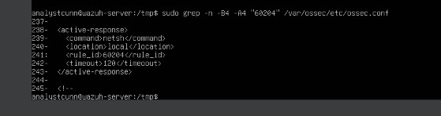

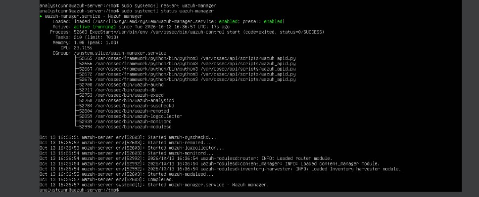

**Verification (and a real fault).** The first live test fired the response but did not block. The agent active-response log recorded "Cannot read 'srcip' from data" and no firewall rule was created (A2-S12d). This is addressed in 4.2.

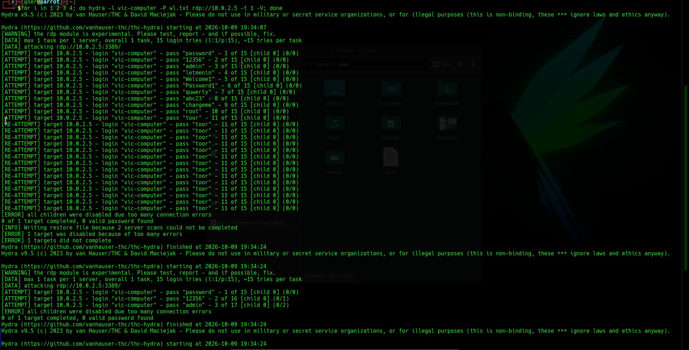

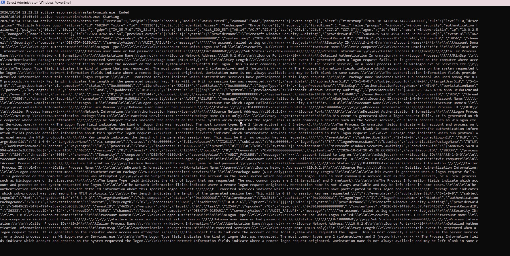

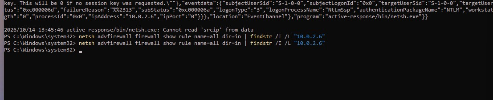

**Framework tags.** NIST IR-4 (incident handling), SC-7 (boundary protection, host firewall), SI-4 (monitoring). CIS Control 13 (Network Monitoring and Defense). MITRE ATT&CK mitigation of T1110 (Brute Force).

### 4.2 Remediating the active-response failure (patch management)

**Risk.** A containment control that silently fails is worse than none, because it looks like the control succeeded, giving a false sense of security. The failure had to be diagnosed, not worked around.

**Change.** The "Cannot read 'srcip'" error was traced to a known regression in Wazuh agent 4.14.7: a new input-validation step routes the source IP through a Windows network call (getaddrinfo) that requires Winsock to be initialized, but the short-lived active-response process never initializes it, so the IP lookup fails and netsh aborts before blocking. This is tracked as Wazuh issue #38739 and fixed in version 4.14.9 (pull request #40084). Because the faulty binary lives on the agent, the remediation was a targeted in-place upgrade of the Windows agent to 4.14.9 (MSI from the official Wazuh package site, run in passive mode). A VM snapshot was taken first. Existing configuration and the agent key were preserved; the agent reconnected to the 4.14.7 manager.

**Verification.** After the upgrade, a re-run of the brute-force produced a live Windows Firewall rule blocking the attacker: RemoteIP 10.0.2.6/32 (A2-S12f), with the agent active-response log showing a clean netsh add and the 120-second timeout delete, and no srcip error (A2-S12g). Agent version confirmed as 4.14.9 and connected (A2-S12e).

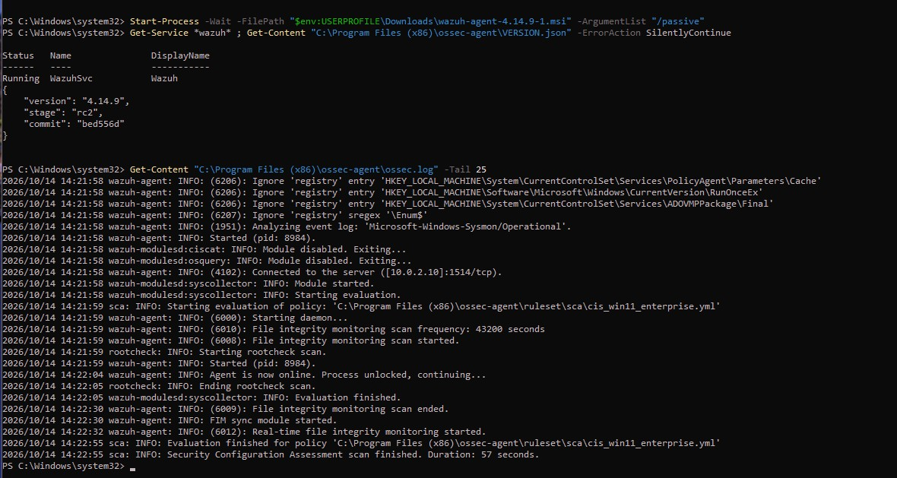

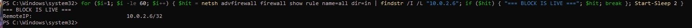

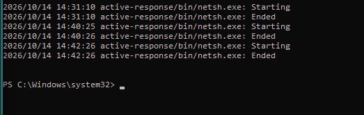

**Framework tags.** NIST SI-2 (flaw remediation). CIS Control 7 (Continuous Vulnerability Management). This stage is as much a portfolio point as the block itself: diagnose from a log line, map to the upstream defect, apply the vendor fix, verify.

### 4.3 Account lockout hardening

**Risk.** A brute-force attack depends on making many password guesses quickly. Without a lockout, the attacker has unlimited attempts.

**Change.** An account lockout policy was set on the endpoint (net accounts: lockout threshold 5, lockout duration 15 minutes, observation window 15 minutes), aligning with CIS guidance. Notably, the host already carried Windows 11's built-in default lockout (threshold 10, enabled by Microsoft in 2022 to blunt RDP brute-force); this change tightens it to 5 and verifies it. The earlier observation that hydra "errored at around 11 attempts" in the detection phase is consistent with that default lockout engaging at 10.

**Verification.** A live re-run of the brute-force from Parrot locked the targeted account after the threshold was crossed. Windows Security event 4740 ("A user account was locked out") recorded the lockout, naming the locked account (vic-computer) and the attacker host (Caller Computer Name: parrot) (A2-S13a, A2-S13d, A2-S13e). The control demonstrably defeats the exact attack.

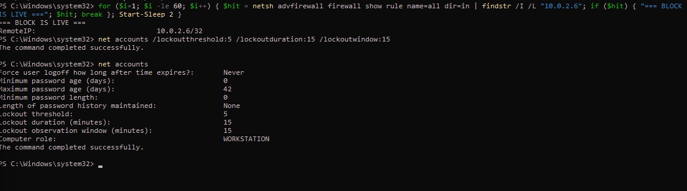

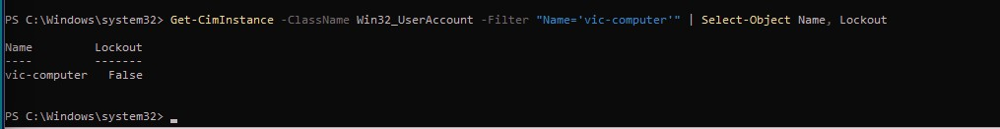

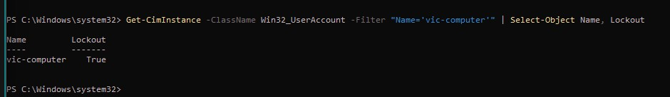

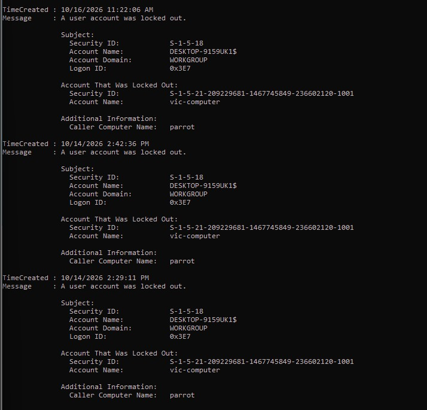

**Framework tags.** NIST AC-7 (unsuccessful logon attempts). CIS Control 6 (Access Control Management). MITRE ATT&CK mitigation M1036 (Account Use Policies) against T1110.

### 4.4 RDP Network Level Authentication (NLA)

**Risk.** Without NLA, Windows opens a Remote Desktop session for any connecting host before validating credentials, exposing more of the system to unauthenticated attackers and wasting resources.

**Change.** NLA was required for RDP by setting UserAuthentication to 1 under the RDP-Tcp registry key (HKLM\SYSTEM\CurrentControlSet\Control\Terminal Server\WinStations\RDP-Tcp). With NLA required, a connection must authenticate before any session is created.

**Verification.** The registry value read back as UserAuthentication : 1 (A2-S13b). The change applies to new RDP connections without a reboot.

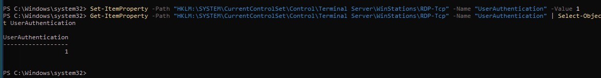

**Framework tags.** NIST AC-17 (remote access), IA-2 (identification and authentication). CIS Control 4 (Secure Configuration of Enterprise Assets). MITRE ATT&CK mitigation of exposed remote services.

## 5. Controls deliberately NOT applied (with rationale)

- **Full-disk encryption (BitLocker).** The correct defense against the utilman offline-SYSTEM trick studied earlier is disk encryption, because that attack needs boot or physical access to alter files on disk. It is documented here as the known mitigation (NIST SC-28, protection at rest) but deferred: inside a VirtualBox VM it involves emulated TPM and recovery-key handling that risk self-lockout and add little teaching value to a network-attack story.
- **Manager upgrade.** The manager was left at 4.14.7 while the agent moved to 4.14.9. The bug lived on the agent, so this fixed it, but it leaves the agent one patch ahead of the manager, which is the non-preferred direction. In production the manager would be upgraded first. The lab snapshot makes the state reversible.
- **Custom active-response script and tuned rules.** The default netsh response and default rule 60204 were used. A custom script reading the Windows event field directly would also solve the srcip case but duplicates what the vendor fix already provides.

## 6. Results and honest interpretation

The endpoint now completes the core SOC loop on a single real attack: detect (rule 60204), respond (automatic firewall block of the attacker), and harden (account lockout and NLA), with a documented patch-management step in the middle.

**What the result shows:** the SIEM auto-contains an RDP brute-force at the host firewall; a tool fault was diagnosed and remediated by applying the upstream fix; and the endpoint is measurably harder to brute-force, proven by locking the attacker out during a live re-run.

**What it does not claim:** this is one endpoint, default rules, and one attack path, in a lab. The block is at the host firewall (a HIDS-driven response), not a network device. The agent runs one patch ahead of the manager, acceptable here but not a production pattern. Full-disk encryption, the control for the physical/offline risk, is documented but not implemented.

## 7. Lessons and troubleshooting highlights

- **A failed control is a finding, not just an error.** The "Cannot read 'srcip'" line turned into the most instructive part of the phase: trace to the upstream regression, apply the vendor patch, verify. Diagnosing beats working around.
- **Read the field name exactly.** The active-response block needs rules_id (plural); the singular rule_id is silently wrong to a human but hard-rejected by the parser.
- **Know the platform defaults.** Windows 11 ships a default account lockout (threshold 10). Recognizing it explained the earlier "hydra stopped at 11" observation and framed the hardening as tightening a default, not creating one.
- **Mind upgrade ordering.** The agent-ahead-of-manager state worked for this fix but is the reverse of the recommended order; the snapshot was the safety net that made the shortcut acceptable.
- **Catch short-lived state deliberately.** The firewall block auto-expires in 120 seconds; a small watch loop captured the live rule rather than racing a manual check.

## Appendix

**Evidence manifest:**

| ID | Proves |
| :-: | :-: |
| A2-S12a / A2-S12a2 | Active-response block configured; manager restarts clean with it loaded |
| A2-S12b | Brute-force re-run executed from Parrot |
| A2-S12c | Active response fired on rule 60204 |
| A2-S12d | The bug: netsh "Cannot read 'srcip'", no block created |
| A2-S12e | Agent patched to 4.14.9 and reconnected |
| A2-S12f | Live Windows Firewall block of RemoteIP 10.0.2.6/32 |
| A2-S12g | Clean netsh add/delete in the active-response log, no srcip error |
| A2-S12h / h2 / h3 | Dashboard view of the rule 60204 alert and attacker detail |
| A2-S13a | Account lockout policy set (threshold 5, duration 15, window 15) |
| A2-S13b | RDP NLA required (UserAuthentication = 1) |
| A2-S13c / A2-S13d | Target account Lockout status before (False) and after (True) |
| A2-S13e | Windows event 4740: vic-computer locked out, caller host "parrot" |

**Tooling / versions:** Wazuh manager 4.14.7; Wazuh agent upgraded 4.14.7 to 4.14.9; Windows 11 Enterprise LTSC 2024 Evaluation; Parrot Security 7.4; hydra 9.5 (rdp module); VirtualBox on ThinkPad T14 (24 GB).

**Framework crosswalk:** NIST 800-53: IR-4, SI-4, SI-2, SC-7, AC-7, AC-17, IA-2, SC-28 (deferred). CIS Controls v8: 4, 6, 7, 13. MITRE ATT&CK: T1110 (Brute Force) with mitigation M1036 (Account Use Policies).

**Reference:** Wazuh issue #38739 and fix PR #40084 (Winsock initialization in Windows active response), resolved in Wazuh 4.14.9.

Raw journals and the full evidence set are retained privately; only the polished report and supporting screenshots are published.
