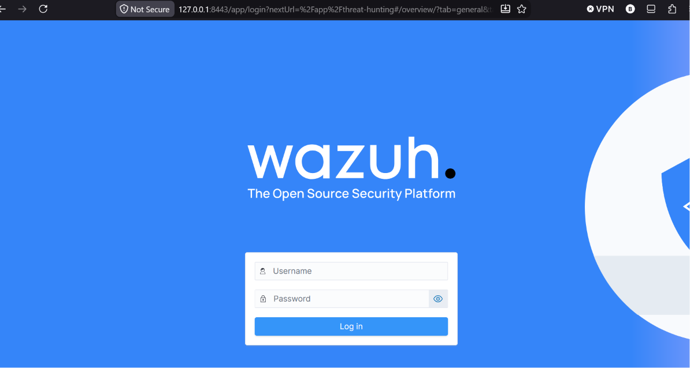
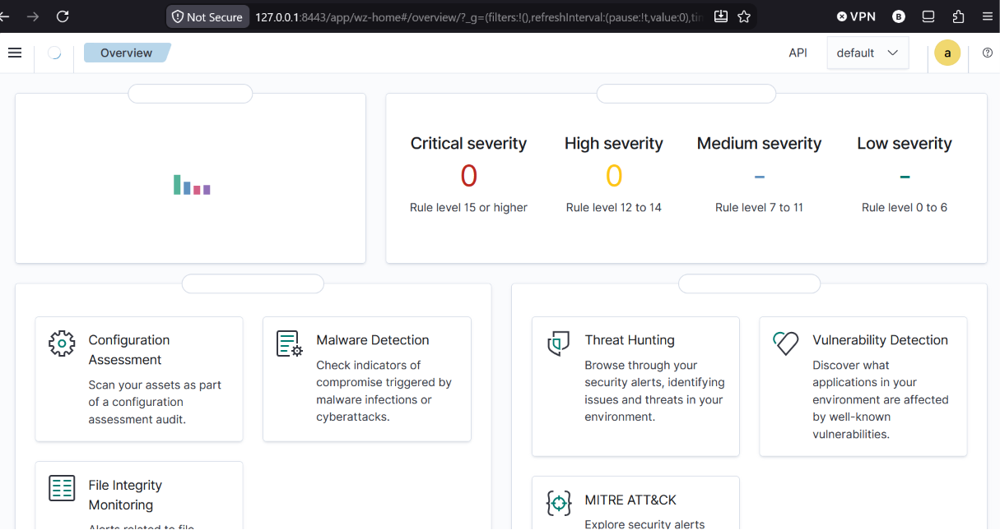
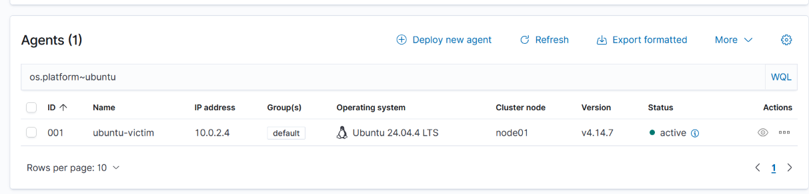
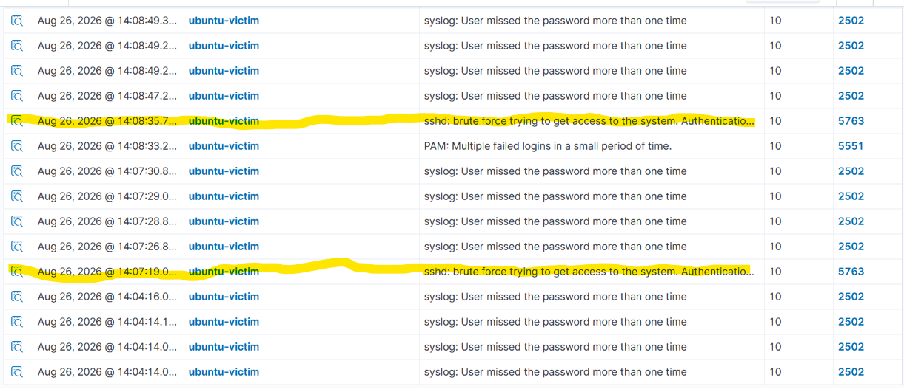
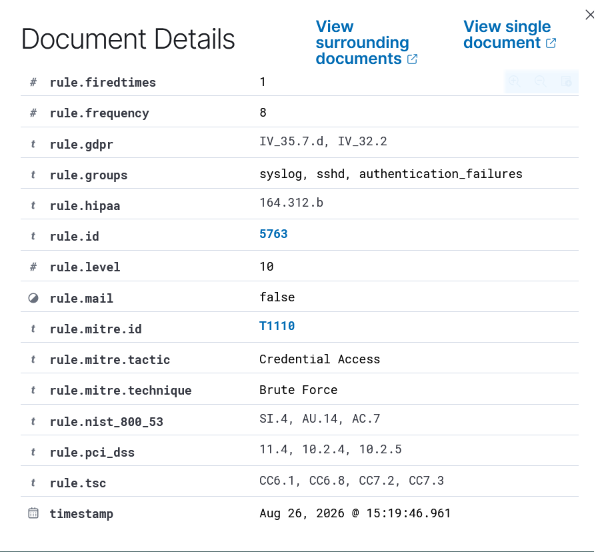

# Artifact 2: SIEM Deployment & Detection with Wazuh

**Analyst:** Brandon Cunningham (`analystcunn`) · Google Cybersecurity Certificate
**Date:** 2026-08-26
**Environment:** Wazuh 4.14.7 all-in-one on Ubuntu Server 24.04.4 LTS; monitored Ubuntu 24.04.4 endpoint; Parrot Security 7.3 attacker; VirtualBox on a ThinkPad T14, isolated NAT Network
**Audience:** SOC / blue-team hiring reviewers (GRC-readable)
**Frameworks:** CIS Controls v8 (spine) + NIST SP 800-53 Rev. 5 tags + MITRE ATT&CK

📄 **[Download the full PDF report](Artifact-2-SIEM-Detection.pdf)**

---

## 1. Executive summary

This project stands up a working **SIEM** (Security Information and Event Management platform) and proves it can **detect and attribute a real attack**. It is the deliberate follow-on to Artifact 1 (which *hardened* an endpoint): having reduced a host's attack surface, the natural next capability is to **see attacks when they happen**.

Using Wazuh 4.14.7 deployed manually as an all-in-one server, I built a three-role lab on an isolated network: a **SIEM manager**, a monitored **Ubuntu victim** running an agent, and a **Parrot attacker**. Then I executed an SSH brute-force with `hydra` and confirmed the SIEM correlated the raw failures into a single, framework-tagged, attributed alert.

| Stage | Capability built | Key result / evidence |
|-------|------------------|------------------------|
| Deploy | Wazuh AIO manager (indexer + manager + dashboard) | Dashboard live at `https://127.0.0.1:8443` (A2-S05) |
| Network | Isolated NAT Network + static server IP | Contained lab; server pinned `10.0.2.10`, survived reboot |
| Enroll | Wazuh agent on the Ubuntu victim | Agent **active**, ID 001, `ubuntu-victim` (A2-S06) |
| Detect | SSH brute-force use-case | Rule **5763** (+5551, +2502), level 10, srcip attributed (A2-S07/S08) |

**Headline result:** the environment went from **zero centralized visibility** to a detection that fires on the *pattern* of ~60 failed logins, names the attacker (`data.srcip 10.0.2.15`) and the targeted account (`data.dstuser vic-computer`), and is **automatically mapped to MITRE ATT&CK T1110 (Brute Force / Credential Access)** and **NIST 800-53 SI-4, AU-14, AC-7**. Detection, not prevention, was the scoped objective, and it is met end to end.

---

## 2. Scope and rationale (read first)

This artifact demonstrates **detection engineering**, and several deliberate choices an interviewer should be expected to probe are stated up front:

- **Manual all-in-one install, not the pre-built OVA.** I installed Wazuh by hand on Ubuntu Server so I could own and evidence every step (and, as it turned out, diagnose three separate install failures). The defensible story is "I built and troubleshot this," not "I imported an appliance."
- **Isolated NAT Network, not bridged.** The lab generates real attack traffic. Putting it on an isolated virtual network contains that traffic and keeps it off the physical LAN, a blast-radius decision, covered in §4.2.
- **Host-based scope (HIDS), not network IDS.** Wazuh's agent watches the endpoint's own logs, file integrity, and processes. This artifact detects from *inside the host*; packet-level/network detection is explicitly out of scope.
- **Detection, not prevention.** The objective was to *see and attribute* the attack. Automatic blocking (active response / `fail2ban`) was deliberately **not** enabled; see §5.
- **A controlled, non-destructive attack.** The brute-force used a wordlist of deliberately wrong passwords, so the account was never actually compromised. The goal was to trigger the *detection*, not to crack the box.

What I deliberately did **not** do (redundant, out-of-scope, or a separate decision) is documented in §5, with the same rigor as the capabilities I did build.

---

## 3. Environment and methodology

**Lab topology (all on isolated VirtualBox NAT Network `LabNet`, `10.0.2.0/24`):**

| Role | VM | OS | Address | Purpose |
|------|-----|-----|---------|---------|
| SIEM manager | `Wazuh-Server` | Ubuntu Server 24.04.4 | **10.0.2.10** (static) | Collect, decode, correlate, alert |
| Monitored endpoint | `Ubuntu-Victim` | Ubuntu Server 24.04.4 | 10.0.2.4 (DHCP) | Runs the Wazuh agent; SSH exposed |
| Attacker | `Parrot-Attacker` | Parrot Security 7.3 | 10.0.2.15 (DHCP) | Runs `hydra` against the victim |

- Host: ThinkPad T14 (16 GB RAM); all VMs on the internal SSD. Server 8 GB / victim 2 GB / attacker 2 GB fits the host with headroom.
- The host reaches the dashboard through a **NAT-Network port-forward** `127.0.0.1:8443 → 10.0.2.10:443`; the browser's `127.0.0.1` is the host talking to itself, distinct from the agent's target `10.0.2.10`.

**Version diligence.** Before deploying I checked Wazuh 4.14's supported-OS matrix and confirmed Ubuntu support tops out at 24.04 (26.04 is unsupported), and verified the Ubuntu Server ISO's SHA256 against the official value; the checksum also caught an earlier accidental *Desktop* download.

**Evidence integrity.** Screenshots are classified **STRONG** (proves a capability/result) or **WORKING NOTE** (context), named `A{artifact}-S{step}-{desc}`, and kept in a private evidence set. Admin credentials are stored **off-portfolio** (never in the repo).

**Baseline (pre-deployment):** no centralized logging, no endpoint telemetry, no detection: an endpoint could be brute-forced with no record correlated anywhere.

---

## 4. Capabilities applied

### 4.1 Centralized SIEM deployment (Wazuh all-in-one)

**Risk.** Without a SIEM, security-relevant events (logins, failures, file changes) sit in scattered local logs on each host, unread and uncorrelated. There is no single place to detect or investigate an attack.

**Change.** Installed Wazuh 4.14.7 all-in-one, comprising the **indexer** (search/storage), **manager** (decoders + detection rules), and **dashboard** (analyst UI), on a patched Ubuntu Server 24.04.4 VM:

```
curl -sO https://packages.wazuh.com/4.14/wazuh-install.sh
sudo bash ./wazuh-install.sh -a
```

**Verification.** After resolving install failures (see §6), `INFO: Installation finished`; the dashboard loaded over HTTPS and authenticated as `admin`. The overview showed the platform live with "no agents registered", the correct pre-enrollment baseline.

**Framework tags.** NIST **AU-6** (audit review, analysis & reporting) and **SI-4** (system monitoring): a SIEM is the mechanism for both; CIS **Control 8** (Audit Log Management).




### 4.2 Isolated lab network + stable addressing

**Risk.** Two failure modes: (a) running attack traffic on the real LAN exposes production devices and is irresponsible; (b) a SIEM/agent target that drifts on a DHCP lease silently breaks reporting and access.

**Change.** Built a VirtualBox **NAT Network** (`LabNet`, `10.0.2.0/24`) so the three VMs can talk to each other and reach the internet while staying **walled off from the physical LAN**, and, because its gateway is virtual, the lab is **portable** (works on any wifi or offline). I then gave the SIEM a **static IP** via netplan so its address never moves:

```
# /etc/netplan/50-cloud-init.yaml (excerpt)
dhcp4: false
addresses: [10.0.2.10/24]
routes: [{to: default, via: 10.0.2.1}]
nameservers: {addresses: [1.1.1.1, 8.8.8.8]}
```

Applied with `sudo netplan try` (120-second auto-revert safety net) after backing up the file.

**Verification.** `hostname -I` = `10.0.2.10`; `ping -c 4 google.com` = 4/4 replies (routing + DNS healthy); the static address **persisted across a reboot** (cloud-init did not overwrite it). Attacker to victim path confirmed later with `ping -c 4 10.0.2.4` = 4/4.

**Framework tags.** NIST **SC-7** (boundary protection, the lab is isolated from the real network) and **CM-6** (configuration settings, addressing managed as code); CIS **Control 12** (Network Infrastructure Management).

### 4.3 Endpoint telemetry via agent enrollment

**Risk.** A SIEM with no agents is blind: it can only see hosts that report to it. The monitored endpoint is an "endpoint blind spot" until it forwards its logs.

**Change.** Installed the Wazuh agent on the victim using the dashboard-generated, version-matched command, pointing it at the manager's **real** address (`10.0.2.10`, not `127.0.0.1`):

```
wget .../wazuh-agent_4.14.7-1_amd64.deb && \
  sudo WAZUH_MANAGER='10.0.2.10' WAZUH_AGENT_NAME='ubuntu-victim' dpkg -i ./wazuh-agent_4.14.7-1_amd64.deb
sudo systemctl daemon-reload && sudo systemctl enable --now wazuh-agent
```

The agent connects *outbound* to the manager (TCP 1514/1515); the manager does not reach into the host.

**Verification.** `systemctl status wazuh-agent` = active (running) with all workers up (`agentd`, `syscheckd`, `logcollector`, `modulesd`); on the dashboard the agent showed **active**, ID **001**, name `ubuntu-victim`, IP 10.0.2.4, agent v4.14.7 (matching the manager).

**Framework tags.** NIST **AU-2** (event logging) and **AU-12** (audit record generation): the agent is the source of endpoint audit records; **SI-4** supporting; CIS **Control 8**.



### 4.4 Detection use-case: SSH brute-force

**Risk.** SSH exposed with password authentication is a standard target for **credential-access brute force** (MITRE ATT&CK **T1110**). The endpoint deliberately runs OpenSSH with password auth *so that this attack path exists to detect*.

**Change (attack).** From the Parrot attacker, generated a controlled brute-force with `hydra` against the victim's SSH, using a 20-entry list of deliberately wrong passwords (run three times, ~60 failed logins):

```
hydra -l vic-computer -P wl.txt ssh://10.0.2.4 -t 4 -V
```

Each failed attempt writes an authentication-failure line to the victim's auth log, which the agent forwards to the manager.

**Verification (detection).** In Threat Hunting, `sshd` returned ~90 events and `rule.level >= 10` returned 16 alerts, spiking exactly at the attack times. The manager **correlated** the individual failures into composite alerts:

- **Rule 5763**: "sshd: brute force trying to get access to the system" (level 10), the headline detection, driven by `rule.frequency` 8 failures in the window.
- **Rule 5551**: "PAM: multiple failed logins in a small period of time" (level 10).
- **Rule 2502**: "syslog: user missed the password more than one time" (level 10).

The expanded alert **attributes** the attack: `data.srcip 10.0.2.15` (the attacker), `data.dstuser vic-computer` (the target), `full_log` "Failed password for vic-computer from 10.0.2.15…", and Wazuh **maps it to frameworks automatically**: MITRE **T1110** (tactic Credential Access, technique Brute Force) and NIST **SI.4 / AU.14 / AC.7** (plus GDPR/HIPAA/PCI-DSS/TSC).

**Framework tags.** NIST **SI-4** (monitoring/detection of the attack), **AU-6/AU-14** (analysis / session audit), **AC-7** (unsuccessful logon attempts), **IR-4** (incident handling, the alert is the trigger); MITRE ATT&CK **T1110**; CIS **Control 8** (Audit Log Management) + **Control 13** (Network Monitoring & Defense).




---

## 5. Controls deliberately NOT applied (with rationale)

- **Active response / blocking (e.g. `fail2ban`, Wazuh active-response).** The scoped objective was **detection**, and mixing in automatic blocking would blur what the artifact demonstrates. Detecting and *responding* are distinct capabilities; response is a deliberate next step, not an omission.
- **Actually compromising the account.** The wordlist was intentionally all-wrong, so the box was never cracked. Triggering the *detection*, not gaining access, was the point, and this keeps the lab responsible and the evidence clean.
- **Full-disk encryption (LUKS) on the servers.** Deliberately omitted on the headless VMs to avoid a boot passphrase blocking unattended reboots; the focus here is detection, not disk hardening. This is a documented contrast with Artifact 1's SC-28 LUKS control on the workstation.
- **Network IDS / packet capture.** Out of scope by design: this is a host-based (HIDS) artifact. A NIDS is a different vantage point (HIDS sees host outcomes, NIDS sees wire traffic) and a separate build.
- **Custom / tuned detection rules.** The detection fired on Wazuh's **default ruleset**, an honest and, for a first use-case, appropriate baseline. Writing custom rules and tuning thresholds/false-positives is a deliberate later phase, not claimed here.
- **Windows agent.** Deferred to Artifact 2 phase 2 for richer telemetry (Security event log, Sysmon, RDP brute-force). Sequencing a light Linux victim first was a resource/realism choice, not a limitation.

---

## 6. Results and honest interpretation

The environment moved from **no visibility** to a complete, attributable detection chain: raw endpoint failures → agent forward → manager correlation → level-10 alert → framework mapping.

What the result **does** show: a functioning SIEM, working host telemetry, and a correlation rule that distinguishes an *attack pattern* from noise and attributes it to a source, the core loop of a SOC.

What it **does not** claim: it is **one** use-case on **one** host using **default** rules, and it is **detection, not prevention**. A single detection working is the start of detection coverage, not proof of a comprehensive one; and seeing an attack is not stopping it. Those are the honest boundaries, and each maps to a named next step (custom rules, more use-cases, active response, more agents).

---

## 7. Lessons and troubleshooting highlights

- **Install failures, three distinct root causes, each read from evidence.** The dashboard install failed twice. First hypothesis (RAM starvation) was **wrong**; reading `/var/log/wazuh-install.log` showed the real cause, `No space left on device`, because Ubuntu's guided LVM allocated only ~half the disk to `/`. Fixed with `lvextend -l +100%FREE -r …` (grew `/` to 48 GB). A later retry failed on **port residue** (1515/55000 held by a half-removed manager); the clean fix was reverting to a pristine snapshot, re-applying the disk fix, and reinstalling. *Lesson: read the logs, don't guess; partial installs leave residue a clean-slate revert beats.*
- **Applied the LVM lesson proactively on the victim:** grew `/` to the full disk during install, so no `lvextend` was needed the second time.
- **Networking as code.** Converting the server to a static IP taught netplan/YAML discipline (space-after-colon, 2-space nesting) and the `netplan try` auto-revert safety net.
- **"Verify, don't guess" (again).** The expected brute-force rule `5712` returned nothing; reading the actual event showed this ruleset files it under **5763**. The data named the rule.
- **External drive dropout during evidence filing.** The portfolio's removable drive briefly dropped its file link mid-session (a recurrence of the Artifact 1 DrvVD issue); VM state was safe on the internal SSD; the affected evidence screenshots were preserved and re-filed. *Lesson: keep VMs on the internal SSD; treat the removable drive as fallible and verify writes.*

---

## Appendix

**Evidence manifest (STRONG):**

| ID | Proves |
|----|--------|
| A2-S05 | Dashboard live over HTTPS (login + authenticated overview) |
| A2-S06 | Agent `ubuntu-victim` enrolled and **active** |
| A2-S07 | Threat Hunting events: brute-force rule 5763 (+5551, +2502) timed to the attack |
| A2-S08 | Expanded rule-5763 alert: srcip 10.0.2.15, MITRE T1110, NIST SI.4/AU.14/AC.7 |

Reserved troubleshooting captures (WORKING/STRONG): ISO checksum verify, `No space left` install error, `lvextend`/`df` disk fix.

**Tooling / versions:** Wazuh 4.14.7 (indexer + manager + dashboard + agent); Ubuntu Server 24.04.4 LTS; Parrot Security 7.3; hydra 9.5; VirtualBox 7.2 on ThinkPad T14 (16 GB).

**Framework crosswalk:** NIST 800-53: AU-2, AU-6, AU-12, AU-14, AC-7, SI-4, SC-7, CM-6, IR-4. CIS Controls v8: 8 (Audit Log Management), 12 (Network Infrastructure), 13 (Network Monitoring & Defense). MITRE ATT&CK: T1110 (Brute Force). Where Wazuh emitted native tags (SI.4 / AU.14 / AC.7 on rule 5763), those are the authoritative per-alert mapping.

*Raw journals, working notes, and the full evidence set are retained privately and available on request; only the polished report, its supporting screenshots, and the PDF are published here.*
